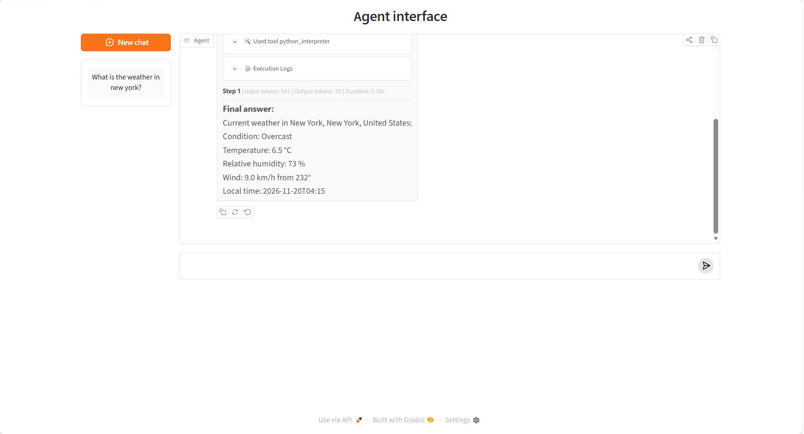

# Smolagents Implementation

A Python-based AI agent built using [Hugging Face smolagents](https://github.com/huggingface/smolagents), exploring LLM integration, tool execution, agent reasoning and autonomous task completion.

<p align="center">
  
</p>

## Overview

This project focuses on implementing a tool-using AI agent with Python and the Hugging Face smolagents framework.

The agent uses a Large Language Model (LLM) to interpret user instructions, determine which tools are required, execute actions and process the results to generate responses.

The implementation follows the agentic **Think – Act – Observe** cycle, where the agent reasons about a task, executes actions through available tools and observes their outputs before producing a final answer.

The project is based on the [Hugging Face Agents Course – Unit 1](https://huggingface.co/learn/agents-course/unit1/smolagents/first_agent), with additional implementation and experimentation.

## Objectives

- Understand the architecture and execution flow of AI agents.
- Implement a CodeAgent using the smolagents framework.
- Integrate an LLM through Hugging Face Inference Providers.
- Develop and integrate custom Python tools.
- Explore tool calling and code execution.
- Build an interactive interface using Gradio.
- Deploy the application using Hugging Face Spaces.

## Features

The agent is designed to support multiple capabilities through tool integration.

| Capability | Description |
|---|---|
| Web Search | Retrieve information from the web using DuckDuckGo. |
| Time Zone Retrieval | Obtain current local time for specified geographical time zones. |
| Image Generation | Generate images from text prompts using a Hugging Face tool. |
| Tool Execution | Select and execute available tools to complete user instructions. |
| LLM Integration | Use a language model to interpret instructions and coordinate tool usage. |
| Interactive Interface | Interact with the agent through a Gradio-based chat interface. |

*Note: Capabilities depend on which tools have been integrated and configured successfully.*

## Technology Stack

- **Programming Language:** Python
- **Agent Framework:** Hugging Face smolagents
- **LLM Integration:** Hugging Face Inference Providers
- **Language Model:** Qwen2.5-Coder-32B-Instruct (initial model configuration)
- **User Interface:** Gradio
- **Web Search:** DuckDuckGo
- **Time Zone Handling:** pytz
- **Configuration:** YAML
- **Version Control:** Git and GitHub
- **Deployment:** Hugging Face Spaces

## Project Structure

```text
smolagents-implementation/
│
├── images/
│   └── smolagent.png
│
├── tools/
│   ├── __init__.py
│   └── custom_tools.py
│
├── app.py
├── agent.py
├── prompts.yaml
├── SYSTEM_DOCUMENTATION.md
├── requirements.txt
├── .env.example
├── .gitignore
└── README.md
